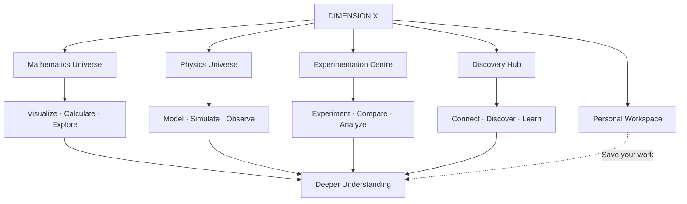

<div align="center">


<br/>

[](#project-status)
[](#technology-stack)
[](#explore-the-universe)

### **EXPLORE. EXPERIMENT. DISCOVER.**

*An interactive scientific universe for exploring Mathematics, Physics, computational thinking, and experimentation.*

</div>

---

## ◈ The idea
dimensionx-livid.vercel.app
**DIMENSION X** turns abstract scientific concepts into interactive digital experiences.

It brings together mathematical tools, physics simulations, graph visualizations, and experimentation environments in one place. The goal is simple: move beyond memorizing equations and make it possible to **see a concept, change its variables, and explore the result**.

> **Don't just read the equation. Explore what it means.**

## ✦ At a glance

<table>
<tr>
<td align="center" width="25%">

### 14
**Mathematics chapters**

</td>
<td align="center" width="25%">

### 14
**Physics chapters**

</td>
<td align="center" width="25%">

### 9
**Experimentation modules**

</td>
<td align="center" width="25%">

### 1
**Connected workspace**

</td>
</tr>
</table>

## 🌌 Explore the universe

<details open>
<summary><strong>📐 Mathematics Universe · 14 chapters</strong></summary>
<br/>

Explore Class XI Mathematics with concept-focused tools, formulas, worked examples, and interactive visualizations.

| # | Chapter | Exploration |
|---:|---|---|
| 01 | Sets | Set operations and Venn diagrams |
| 02 | Relations and Functions | Relations, mappings and functions |
| 03 | Trigonometric Functions | Trigonometric relationships and unit-circle concepts |
| 04 | Complex Numbers and Quadratic Equations | Complex plane and quadratic solving |
| 05 | Linear Inequalities | Inequality regions and solutions |
| 06 | Permutations and Combinations | Counting principles |
| 07 | Binomial Theorem | Expansion and Pascal's triangle |
| 08 | Sequences and Series | AP, GP and series |
| 09 | Straight Lines | Coordinate geometry |
| 10 | Conic Sections | Conic exploration |
| 11 | Introduction to Three-Dimensional Geometry | 3D coordinates |
| 12 | Limits and Derivatives | Introductory calculus |
| 13 | Statistics | Statistical analysis |
| 14 | Probability | Probability concepts |
</details>

<details open>
<summary><strong>⚛️ Physics Universe · 14 chapters</strong></summary>
<br/>

Explore physical principles through computational models, parameter controls, scientific plots, and simulations.

| # | Chapter | Exploration |
|---:|---|---|
| 01 | Units and Measurements | Units, dimensions and measurement |
| 02 | Motion in a Straight Line | One-dimensional kinematics |
| 03 | Motion in a Plane | Vectors and projectile motion |
| 04 | Laws of Motion | Forces and free-body concepts |
| 05 | Work, Energy and Power | Work-energy relationships |
| 06 | System of Particles and Rotational Motion | Centre of mass and rotation |
| 07 | Gravitation | Gravitational models |
| 08 | Mechanical Properties of Solids | Elasticity |
| 09 | Mechanical Properties of Fluids | Fluid behaviour |
| 10 | Thermal Properties of Matter | Heat and thermal behaviour |
| 11 | Thermodynamics | Thermodynamic processes |
| 12 | Kinetic Theory | Molecular model of gases |
| 13 | Oscillations | Simple harmonic motion |
| 14 | Waves | Wave behaviour and superposition |
</details>

<details open>
<summary><strong>🧪 Experimentation Centre</strong></summary>
<br/>

A digital laboratory for changing parameters, testing ideas, and observing model behaviour.

| Lab | What it explores |
|---|---|
| Equation Graph Studio | 2D/3D equation visualization |
| Mathematical Sandbox | Interactive mathematical models |
| 3D Math Universe | Mathematical surfaces |
| Virtual Physics Lab | Physics model experiments |
| Collision Lab | Collision behaviour |
| Mandelbrot Explorer | Fractal patterns |
| Logistic Chaos Map | Nonlinear dynamics |
| Data Regression | Data fitting and trends |
| Model Comparison | Comparing mathematical models |
| Custom Model Creator | Building custom models |

</details>

<details>
<summary><strong>🔭 Discovery Hub</strong></summary>
<br/>

- **Formula Vault** — a searchable reference for Mathematics and Physics.
- **Scientific Timeline** — explore milestones in scientific discovery.
- **Knowledge Nexus** — visual connections between ideas.
- **Sustainability Models** — mathematical models related to real-world sustainability.
</details>

<details>
<summary><strong>💾 Personal Workspace</strong></summary>
<br/>

Keep your work together with:

- Research notes
- Saved equations
- Saved graphs
- Saved experiments
- Bookmarks

Workspace data is stored locally in the browser using `localStorage`.
</details>

<details>
<summary><strong>🤖 AI Intelligence</strong></summary>
<br/>

<div align="center">


### TO BE ADDED

An intelligent layer is planned for a future phase of DIMENSION X. **AI functionality is not currently available.**

</div>
</details>

## ⌁ How the experience connects



## 🧭 The project philosophy

<div align="center">

| **01 · EXPLORE** | **02 · EXPERIMENT** | **03 · DISCOVER** |
|:---:|:---:|:---:|
| Approach concepts with curiosity. | Change variables and test assumptions. | Build understanding from what you observe. |

</div>

## 🛠️ Technology stack

<div align="center">


</div>

| Technology | Role |
|---|---|
| React + TypeScript | Application interface and typed code |
| Vite | Development server and build tooling |
| Tailwind CSS | Styling system |
| Three.js / React Three Fiber / Drei | 3D graphics and experiences |
| GSAP / Framer Motion | Animation and transitions |
| Plotly.js | Interactive graphing |
| Math.js | Mathematical computation |
| KaTeX | Mathematical notation |

## 🚀 Run locally

### Prerequisites

- [Node.js](https://nodejs.org/) (LTS recommended)
- npm
- Git

### Installation

**1. Clone the repository**

```bash
git clone https://github.com/sakshamaryaa/DIMENSION_X.git
```

**2. Enter the project directory**

```bash
cd DIMENSION_X
```

**3. Install dependencies**

```bash
npm install
```

**4. Start the development server**

```bash
npm run dev
```

**5. Open the local address**

Use the URL printed in your terminal (Vite commonly uses `http://localhost:5173`).

## 🗺️ Project status


DIMENSION X is an evolving project. Features, models, and interfaces may change as development continues. Scientific outputs should be checked against appropriate theory and assumptions before being used for formal work.

| Area | Status |
|---|---|
| Mathematics Universe | Core module implemented; ongoing validation |
| Physics Universe | Core module implemented; ongoing validation |
| Experimentation Centre | Implemented; ongoing refinement |
| Discovery Hub | Implemented; ongoing refinement |
| Personal Workspace | Local browser storage |
| AI Intelligence | Coming Soon |

## 👨‍💻 Creator

<div align="center">

### **SAKSHAM ARYA**
**aka MR. VORTEX**

Student Developer · Technology Enthusiast · Creator

Interested in Mathematics, Physics, Programming, Robotics, Scientific Computing, and Digital Innovation.

</div>

## 🤝 Feedback

Found an issue or have an idea to improve DIMENSION X? Open a [GitHub Issue](https://github.com/sakshamaryaa/DIMENSION_X/issues) with a clear description and steps to reproduce it.

## 📜 License

No license has been specified yet. Until a license is added to the repository, the project remains under its default copyright; do not assume permission to reuse or redistribute its code.

---

<div align="center">

### **BUILT WITH CURIOSITY. DRIVEN BY DISCOVERY.**

**DIMENSION X** · *Explore. Experiment. Discover.*

<sub>Created by Saksham Arya · 2026</sub>

</div>
